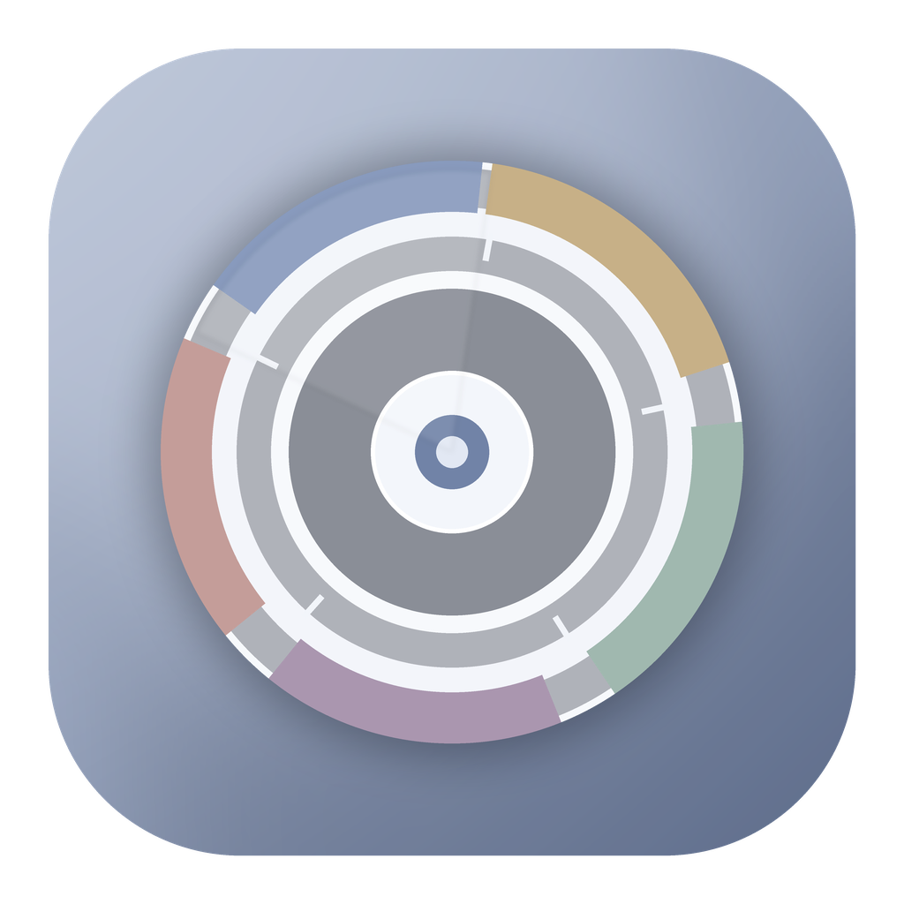
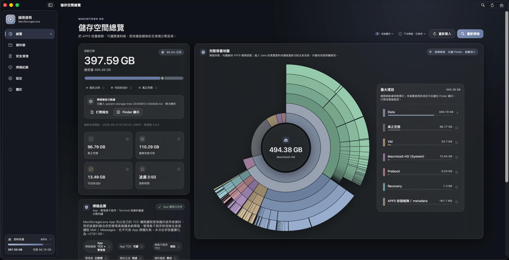

<p align="center">
  
</p>

# MacStorageLens（磁碟透視）

**原生 SwiftUI macOS 儲存空間分析、一鍵安全清理與檔案整理工具。**

MacStorageLens 顯示磁碟容量、各資料夾的占用空間，以及尚未解析到路徑的容量差額。一鍵清理會重新掃描並直接移除符合條件的已知快取與舊診斷；檔案整理則由使用者選取、確認後移到垃圾桶。詳細條件與清理後果見[清理邏輯](docs/cleanup-logic.md)。

- **版本**：2.0.0（Build 36）
- **Scanner**：2.5.4
- **最低系統**：macOS 14
- **開發者 / Author**：**Jason Chen**
- **授權**：MIT


## 畫面預覽

### 儲存空間總覽



上圖為早期版本畫面；2.0.0 已調整頁面文字與安全清理介面。

## 主要功能

- APFS / volume / free-space / directory-tree 容量分析與 Markdown 報告。
- 容量總覽、資料樹與可鑽取 Sunburst 視覺化。
- 一鍵安全清理：重新掃描後直接清除符合期限的已知快取與舊診斷，不經垃圾桶。
- 五種人工整理：專案建置資料、安裝檔、大型與舊檔、完整內容重複比對、程式與關聯資料。
- 保留清單、判斷原因、內容檢視、取消與本機清理紀錄。
- 進階規則保留六級安全清理：超級保守、保守、平衡、激進、超激進、自定義。
- Finder 可見垃圾桶與「直接徹底刪除」兩條明確執行路徑。
- 外接磁碟、SD/USB 與部分 NAS/遠端掛載的 capability-aware 行為。
- AppleDouble、App cache、開發工具 cache、package-manager cache、App leftovers、logs/diagnostics 等受控規則。
- 高風險資料、廢紙簍永久清空、系統管理項目均需額外明確啟用；不會因升級偷偷加入既有偏好。
- 清理前 live revalidation；掃描結果本身不是刪除授權。

## 快速開始

### 建立原生 App

Finder 中雙擊：

```text
scripts/建立並啟動.command
```

腳本會以 SwiftPM release 模式建立：

```text
dist/MacStorageLens.app
```

第一次使用完整系統掃描時，macOS 可能要求「完整磁碟存取權」或外接卷宗權限。請只授予你確實需要的權限。

### 直接執行開發版

```bash
swift run MacStorageLens
```

或雙擊：

```text
scripts/只執行開發版.command
```

## 驗證

在 macOS 雙擊：

```text
scripts/驗證原始碼.command
```

驗證包含 package manifest、Swift parser/compiler regression、cleanup filesystem fixtures、UI/static contracts、增量索引、安全邊界與 macOS release build。跨平台可重跑的驗證原始碼保留在 `Verification/`；大量歷史產物與機器路徑輸出刻意未納入公開 repository。

## 專案結構

```text
MacStorageLens/
├── Sources/MacStorageLens/   # SwiftUI/AppKit app 與核心邏輯
├── Resources/                # Scanner scripts 與 App icon
├── Verification/             # 可重跑的 Swift/Python 驗證原始碼
├── ThirdParty/               # 第三方授權副本
├── scripts/                  # 建置、執行、驗證入口
├── docs/                     # 架構、安全清理與目前 release 文件
├── Package.swift
├── SECURITY.md
├── CHANGELOG.md
└── LICENSE
```

更完整架構請看 [`docs/ARCHITECTURE.md`](docs/ARCHITECTURE.md)。清理等級請看 [`docs/CLEANUP_PROFILE_REFERENCE.md`](docs/CLEANUP_PROFILE_REFERENCE.md)。

## 安全設計

清理遵循以下原則：

1. 掃描、候選判定、實際刪除分層。
2. 高風險候選預設不選取。
3. 執行前重新驗證 path、類型、symlink/package、volume capability 等條件。
4. Finder Trash 與永久刪除不互相偷偷 fallback。
5. 永久刪除不等於安全覆寫或鑑識級抹除。

詳見 [`SECURITY.md`](SECURITY.md)。

## 2.0.0

安全清理改為一鍵處理與五種人工整理工具。完整說明：[版本更新](docs/release-notes/2.0.0.md)、[清理邏輯](docs/cleanup-logic.md)、[研究對照](docs/cleanup-research.md)、[維護與擴充](docs/cleanup-development.md)。

## 1.8.0

針對本機 macOS 環境改善總覽／資料樹讀取與安全清理：可驗證的目錄位置索引、原生 AppleDouble 列舉、Mole 保護清單、執行中程式快取與共用開發環境保護。完整說明與實測範圍見 [`docs/release-notes/1.8.0.md`](docs/release-notes/1.8.0.md)。

## 1.7.6

修正較新 macOS 上中文及其他 Unicode 資料夾名稱變成問號的問題。更新後請重新掃描受影響位置；已經寫成問號的舊報告無法還原名稱。沿用原始碼 ZIP 與既有 SwiftPM 建置入口，沒有新增套件依賴。完整 release notes：[`docs/release-notes/1.7.6.md`](docs/release-notes/1.7.6.md)。

## 第三方來源

部分垃圾判定規則研究參考 [MacSai](https://github.com/iliyami/MacSai)（BSD 3-Clause）。MacSai 原始碼不直接編譯進 MacStorageLens；來源追蹤與授權副本請看 [`THIRD_PARTY_NOTICES.md`](THIRD_PARTY_NOTICES.md) 與 `ThirdParty/MacSai-LICENSE.txt`。

## License

MacStorageLens © 2026 **Jason Chen**，依 [MIT License](LICENSE) 發布。第三方元件/研究來源依各自授權條款。
